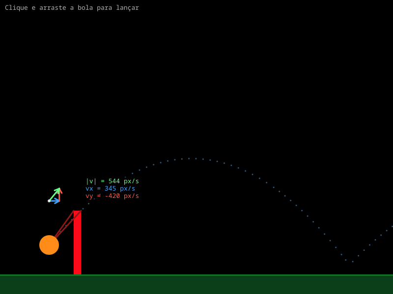
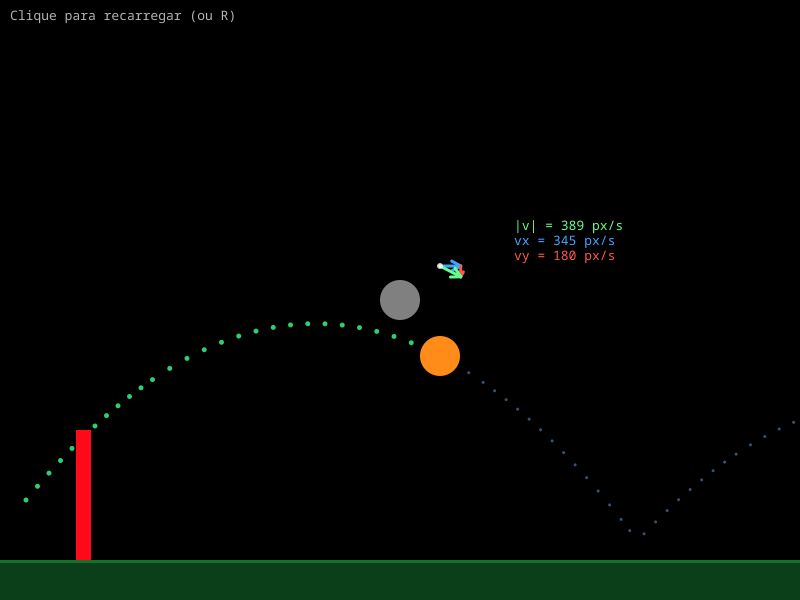

# Parabolic Movement Simulation

Simulação interativa de lançamento parabólico com estilingue, escrita em **Lua** para **LÖVE 11**. O projeto une um estilingue arrastável, previsão de trajetória, rastro, colisão elástica com o chão, câmera horizontal infinita e uma ilustração em tempo real do vetor velocidade com suas componentes.

| Mira | Em voo |
|:---:|:---:|
|  |  |

*Prévias geradas a partir das próprias chamadas de desenho do jogo (800×600).*

---

## Sumário

- [Sobre o projeto](#sobre-o-projeto)
- [Funcionalidades](#funcionalidades)
- [Como jogar](#como-jogar)
- [Requisitos](#requisitos)
- [Instalação e execução](#instalação-e-execução)
- [Controles](#controles)
- [O que aparece na tela](#o-que-aparece-na-tela)
- [Física por trás da simulação](#física-por-trás-da-simulação)
- [Câmera horizontal](#câmera-horizontal)
- [Ilustração do vetor velocidade](#ilustração-do-vetor-velocidade)
- [Arquitetura do código](#arquitetura-do-código)
- [Configuração](#configuração)
- [Como estender o projeto](#como-estender-o-projeto)
- [Validação](#validação)
- [Limitações conhecidas](#limitações-conhecidas)
- [Solução de problemas](#solução-de-problemas)
- [Roadmap](#roadmap)
- [Licença](#licença)

---

## Sobre o projeto

Este é um projeto de estudo de **cinemática**, **vetores** e **colisões** transformado em um brinquedo interativo. A ideia é permitir que qualquer pessoa veja, na prática, como a velocidade de um projétil se decompõe em uma parte horizontal constante e uma parte vertical que muda com a gravidade.

O programa simula uma bola lançada por um estilingue. Você clica na bola, puxa e solta; a bola descreve uma parábola, quica no chão e continua viajando horizontalmente sem limite. Enquanto isso, o jogo mostra:

- o caminho já percorrido (rastro verde);
- o caminho que ainda vai ser percorrido nos próximos segundos (pontos azuis);
- o vetor velocidade acima da bola, com as componentes `vx` e `vy`, o módulo `|v|` e os valores numéricos.

O código foi dividido em módulos pequenos, cada um com uma responsabilidade clara, para servir também como exemplo de organização de um projeto LÖVE.

### Destaques

- **Física analítica**, não integração de Euler: a posição é calculada pela equação da parábola a cada frame.
- **Previsão e rastro determinísticos**: a previsão usa exatamente a mesma função de física da bola real.
- **Mundo horizontal infinito** com câmera que mantém a bola visível.
- **Vetor velocidade animado**: as setas e os números mudam a cada frame.
- **Sem assets externos**: tudo é desenhado com primitivas do LÖVE (círculos, retângulos e linhas).
- **Configuração centralizada** em `src/config.lua`.

---

## Funcionalidades

- Estilingue com clique, arrasto e soltura.
- Puxada limitada a `maxPull` pixels, com lançamento proporcional à puxada.
- Lançamento no sentido **oposto** à puxada (como um estilingue de verdade).
- Prévia da trajetória futura em tempo real enquanto você mira.
- Rastro do caminho já percorrido.
- Colisão com o chão com restituição configurável (quique).
- Sem paredes laterais: a bola pode ir ao infinito para a esquerda ou para a direita.
- Câmera horizontal com zona morta para acompanhar a bola.
- Ilustração do vetor velocidade:
  - componente horizontal `vx` em azul;
  - componente vertical `vy` em vermelho;
  - vetor resultante `|v|` em verde;
  - painel numérico com `|v|`, `vx` e `vy` em px/s.
- Recarga com clique ou tecla `R`.
- Suporte a redimensionamento de janela (quando habilitado no `conf.lua`).
- Física independente da taxa de quadros (baseada em `dt` e em equações analíticas).
- Código modular, sem dependências além do próprio LÖVE.

---

## Como jogar

1. Execute o projeto com `love .` (veja [Instalação e execução](#instalação-e-execução)).
2. **Clique na bola**, que fica no topo do poste vermelho.
3. **Arraste** mantendo o botão esquerdo pressionado. A bola segue o mouse, os elásticos se esticam e a prévia azul mostra o caminho que ela faria se fosse solta naquele instante.
4. **Solte** para lançar. A bola sai no sentido contrário ao da puxada: puxou para baixo e para a esquerda, ela vai para cima e para a direita.
5. Observe o rastro verde, a prévia azul e o vetor velocidade mudando enquanto a bola voa e quica.
6. **Clique em qualquer lugar** durante o voo (ou aperte `R`) para recarregar a bola no lançador.

> **Dica:** se você soltar com uma puxada menor que 8 px, o lançamento é cancelado e a bola volta para o lançador.

### Sentido do lançamento

O vetor de lançamento é o **oposto** do vetor de puxada:

```text
puxada     p = bola - âncora
lançamento v = (âncora - bola) * launchPower = -p * launchPower
```

Por isso, para lançar para cima e para a direita, puxe a bola para baixo e para a esquerda.

---

## Requisitos

- **LÖVE 11.x** — testado com **LÖVE 11.5**.
  - O LÖVE já inclui o interpretador Lua (LuaJIT 2.1, compatível com Lua 5.1).
- Nenhuma biblioteca externa.
- Sistema operacional com suporte ao LÖVE: Linux, Windows ou macOS.
- Para executar, é necessário um ambiente gráfico. O código também pode ser validado sem janela com um mock do módulo `love` (veja [Validação](#validação)).

---

## Instalação e execução

### Executar a partir do diretório do projeto

```bash
cd Parabolic-Movement-Simulation
love .
```

### Executar informando o caminho

```bash
love /caminho/para/Parabolic-Movement-Simulation
```

### Empacotar como `.love`

O arquivo `.love` é um ZIP com `main.lua` na raiz:

```bash
cd Parabolic-Movement-Simulation
zip -9 -r ../parabolic-movement.love main.lua src
love ../parabolic-movement.love
```

> **Importante:** execute a partir da raiz do projeto. Os `require("src.xxx")` são resolvidos relativos ao diretório de trabalho do jogo. Se você rodar `lua main.lua` diretamente (fora do LÖVE), verá um erro do tipo `module 'love' not found`, porque o módulo `love` só existe dentro do runtime do LÖVE ou em um mock.

### Janela e redimensionamento

O projeto **não inclui** um `conf.lua`, então o LÖVE usa os padrões: janela de **800×600**, título padrão e `resizable = false`. O código já implementa `love.resize` e funciona corretamente quando a janela é redimensionada, mas para permitir que o usuário redimensione é preciso criar um `conf.lua`:

```lua
-- conf.lua
function love.conf(t)
    t.identity = "parabolic-movement"
    t.version = "11.5"

    t.window.title = "Parabolic Movement Simulation"
    t.window.width = 1024
    t.window.height = 720
    t.window.resizable = true
    t.window.vsync = 1
end
```

Com esse arquivo, o chão, o lançador, a âncora e a câmera se ajustam ao novo tamanho.

---

## Controles

| Ação | Como fazer |
|---|---|
| Mirar | Clique na bola (topo do lançador) e arraste com o botão esquerdo |
| Lançar | Solte o botão esquerdo após puxar pelo menos 8 px |
| Cancelar o lançamento | Solte com uma puxada menor que 8 px |
| Recarregar | Clique em qualquer lugar durante o voo ou pressione `R` |
| Redimensionar | Requer `conf.lua` com `t.window.resizable = true` |

O jogo usa apenas o **botão esquerdo** do mouse. Durante o arrasto, o cursor customizado é escondido, pois a própria bola já segue o mouse.

---

## O que aparece na tela

| Elemento | Aparência | Papel |
|---|---|---|
| Chão | Faixa verde-escura de 40 px, com borda superior de 3 px | Superfície onde a bola quica |
| Lançador | Poste vermelho de 15×130 px | Define a âncora de lançamento no topo |
| Elásticos | Duas linhas vermelho-escuras | Ligam o topo do poste à bola durante a mira |
| Bola | Círculo laranja de raio 20 px | Projétil |
| Rastro | Bolinhas verdes de raio 2,5 px | Caminho já percorrido |
| Previsão | Bolinhas azuis de raio 1,5 px | Caminho futuro simulado |
| Vetor velocidade | Setas azul (`vx`), vermelha (`vy`) e verde (resultante) | Decomposição da velocidade |
| Painel | Fundo preto translúcido com três linhas coloridas | Valores numéricos em px/s |
| Cursor | Círculo branco translúcido de raio 20 px | Posição do mouse (oculto no arrasto) |
| Dica | Texto no canto superior esquerdo | Instrução do estado atual |

### Ordem de desenho

```text
1. chão (espaço da tela, fora da câmera)
2. push + translate(-cameraX, 0)
3. previsão (bolinhas azuis)
4. rastro (bolinhas verdes, apenas em voo)
5. lançador e elásticos
6. bola
7. vetor velocidade e painel numérico
8. pop
9. cursor
10. dica
```

O chão fica **fora** da translação da câmera porque ele é uma faixa fixa da tela (o mundo é infinito horizontalmente, mas o chão sempre ocupa a largura visível). O cursor e a dica também ficam fora, pois usam coordenadas de tela.

---

## Física por trás da simulação

### Sistema de coordenadas e unidades

O projeto usa o sistema de coordenadas da tela:

```text
(0, 0) ─────────────► +x
   │
   │
   ▼
  +y
```

- `+x` aponta para a direita.
- `+y` aponta para **baixo** (convenção de tela).
- Valores negativos de `y` representam movimento para **cima**.
- Unidades: pixels (`px`), segundos (`s`), pixels por segundo (`px/s`) e pixels por segundo ao quadrado (`px/s²`).
- A gravidade é positiva (`500 px/s²`) porque aponta para baixo.

### Estado da bola

A bola é uma tabela com os campos abaixo:

| Campo | Significado |
|---|---|
| `radius` | Raio da bola (20 px) |
| `x0`, `y0` | Origem do segmento parabólico atual |
| `dx` | Velocidade horizontal (constante) |
| `dy0` | Velocidade vertical inicial do segmento atual |
| `dy` | Velocidade vertical no instante atual |
| `t` | Tempo desde o início do segmento atual |
| `x`, `y` | Posição atual |

O conceito de **segmento** é importante: cada parábola vai de um lançamento ou quique até o próximo quique. Quando a bola quica, `x0`, `y0`, `dy0` e `t` são recalculados, mas `dx` permanece o mesmo.

### Equações do movimento

Para cada segmento, a posição e a velocidade vertical são calculadas analiticamente:

```text
x(t)  = x0 + dx * t
y(t)  = y0 + dy0 * t + 0.5 * g * t^2
vy(t) = dy0 + g * t
```

Onde `g = 500 px/s²`.

- A velocidade horizontal `dx` **não muda** durante o voo (não há resistência do ar).
- A velocidade vertical muda linearmente com o tempo.
- A posição é a solução exata de uma aceleração constante, avaliada a cada frame.
- Isso é diferente de uma integração numérica como Euler, que acumularia erro.

### O estilingue

A âncora é o topo do lançador:

```lua
anchor.x = launcher.x + launcher.width / 2
anchor.y = launcher.y
```

Com os valores padrão (janela 800×600):

```text
launcher.x = 150
launcher.width = 15
launcher.y = 560 - 130 = 430

anchor = (157.5, 430)
```

Ao arrastar, a puxada é limitada a `maxPull = 120 px`:

```lua
local dx, dy = x - anchor.x, y - anchor.y
local dist = math.sqrt(dx * dx + dy * dy)

if dist > config.maxPull then
    dx = dx / dist * config.maxPull
    dy = dy / dist * config.maxPull
end
```

A bola também é mantida dentro da tela e acima do chão:

```lua
ball.x = math.max(ball.radius, math.min(w - ball.radius, anchor.x + dx))
ball.y = math.max(ball.radius, math.min(groundObj.y - ball.radius, anchor.y + dy))
```

No lançamento:

```lua
ball.dx  = (anchor.x - ball.x) * config.launchPower
ball.dy0 = (anchor.y - ball.y) * config.launchPower
```

Com `launchPower = 6`, a velocidade máxima é:

```text
120 px * 6 (px/s)/px = 720 px/s
```

### Previsão da trajetória

Enquanto você mira, o jogo precisa saber para onde a bola iria se fosse solta naquele instante. Para isso:

1. Cria uma **cópia** do estado da bola com a velocidade pendente.
2. Avança essa cópia em passos fixos de `previewDt = 1/120 s`.
3. Para quando `elapsed >= previewTime` (3 s) ou quando atinge o limite de pontos.
4. Guarda um ponto a cada `previewSpacing = 14 px` de deslocamento.
5. Desenha esses pontos como bolinhas azuis.

Como a previsão usa a mesma função `physics.step` da bola real, ela também prevê os **quiques** no chão.

O limite é `maxPreviewNumbers = 600` **números** no array. Como cada ponto ocupa dois números (`x` e `y`), isso equivale a no máximo **300 pontos**.

Durante o voo, a mesma previsão é recalculada a cada frame a partir da posição atual, então os pontos azuis mostram sempre o futuro a partir de onde a bola está.

### Rastro

O rastro é independente da previsão:

- A cada `trailSpacing = 14 px` percorridos, um novo ponto é adicionado.
- O limite é `maxTrailNumbers = 1200` números, ou **600 pontos**.
- Quando o limite é ultrapassado, os pontos mais antigos são removidos.
- O rastro é limpo no lançamento e na recarga.
- Ele só é desenhado durante o voo (enquanto você mira, aparece apenas a previsão).

O array é **plano**: `{x1, y1, x2, y2, ...}`. Isso evita criar uma tabela por ponto e deixa o desenho simples.

### Colisão com o chão e quiques

O topo do chão fica em:

```lua
groundY = h - config.groundHeight
```

Com 800×600 e `groundHeight = 40`, `groundY = 560`.

A colisão é detectada quando a borda inferior da bola alcança o chão:

```lua
if s.y + s.radius >= groundY then
    s.x0 = s.x
    s.y0 = groundY - s.radius
    s.dy0 = -s.dy * config.restitution
    s.y = s.y0
    s.t = 0
end
```

O que acontece:

- A posição vertical é **corrigida** para a bola ficar exatamente em cima do chão (`y0 = groundY - radius`).
- A velocidade vertical é **invertida** e multiplicada por `restitution = 0.8`.
- O tempo `t` volta a zero, iniciando um novo segmento parabólico.
- A posição horizontal `x` e a velocidade horizontal `dx` **não são alteradas**.

### Por que a bola vai ao infinito

Não existem paredes laterais no código. A velocidade horizontal `dx` nunca é invertida nem amortecida, então a bola continua se deslocando para sempre. Os quiques só afetam o movimento vertical.

Em termos de energia:

- A cada quique, a velocidade vertical fica com 80% do valor anterior.
- A energia cinética vertical é proporcional ao quadrado da velocidade, então sobra `0.8² = 0.64` (64%) da energia vertical.
- A energia cinética horizontal permanece constante.
- Com o tempo, os quiques ficam cada vez menores, mas o movimento horizontal continua.

### Precisão e limitações do método

O passo da física é analítico, mas a colisão é detectada **depois** de avançar o tempo. Se a bola ultrapassar o chão dentro de um frame, a posição é corrigida, mas a velocidade usada no quique é a do fim do passo, que pode incluir um pequeno excesso de tempo. Isso introduz um erro pequeno de energia/tempo no quique, imperceptível na simulação.

Além disso, quando a velocidade vertical é muito pequena, a bola pode fazer micro-quiques em vez de repousar perfeitamente. Visualmente isso é irrelevante.

### Independência da taxa de quadros

- O voo usa equações analíticas em função de `t`, então a trajetória não depende do FPS (a menos do pequeno erro de colisão descrito acima).
- A previsão usa um `dt` interno fixo de `1/120 s`, garantindo resultados consistentes.
- O rastro é amostrado por **distância**, não por frame.
- A câmera é posicional, sem acumular erro.

---

## Câmera horizontal

O mundo não tem mais limite lateral, então a bola poderia sair da tela. Para resolver isso, o jogo usa uma câmera horizontal com **zona morta**.

### Mundo versus tela

- `ball.x` é a coordenada no **mundo**.
- `cameraX` é o deslocamento da câmera.
- A posição na **tela** é:

```text
screenX = ball.x - cameraX
```

### Regra da zona morta

A bola deve permanecer entre `cameraLeft` e `cameraRight` da largura da tela. Com os valores padrão:

```text
cameraLeft  = 0.10  →  80 px  (em 800 px)
cameraRight = 0.55  → 440 px  (em 800 px)
```

A atualização é:

```lua
local left = w * config.cameraLeft
local right = w * config.cameraRight
local screenX = ball.x - cameraX

if screenX < left then
    cameraX = ball.x - left
elseif screenX > right then
    cameraX = ball.x - right
end
```

```text
0        80                    440             800
|---------|------- zona morta ---|---------------|
          ↑ a bola fica presa aqui ao viajar →
```

Na prática:

- Enquanto a bola está dentro da zona morta, a câmera não se move.
- Se ela passa da margem direita, a câmera avança e mantém a bola em `440 px`.
- Se ela passa da margem esquerda, a câmera recua e mantém a bola em `80 px`.
- Ao recarregar, `cameraX` volta a `0`.

### Desenho com translação

O mundo é desenhado com:

```lua
love.graphics.push()
love.graphics.translate(-cameraX, 0)

-- previsão, rastro, lançador, bola, vetor

love.graphics.pop()
```

O chão é desenhado **antes** do `push`, no espaço da tela, porque ele é uma faixa fixa e infinita visualmente. O cursor e a dica também ficam fora da translação.

### Coordenadas do mouse

Durante a mira, `cameraX` é sempre `0` (a câmera só se move em voo), então as coordenadas do mouse coincidem com as coordenadas do mundo. Se você alterar o comportamento da câmera para se mover durante a mira, será necessário converter:

```lua
worldX = mouseX + cameraX
```

### Por que o painel do vetor cabe na tela

O texto do painel começa em `ball.x + 74`, mas o fundo começa 6 px antes (`ball.x + 68`) e tem 150 px de largura. Com a bola presa em `440 px` (margem direita), a borda direita do fundo fica em:

```text
440 + 68 + 150 = 658 px
```

Como a janela tem 800 px, o painel continua visível. Na margem esquerda (80 px), ele termina em 298 px.

---

## Ilustração do vetor velocidade

O módulo `src/velocity.lua` desenha a decomposição da velocidade acima da bola. O objetivo é mostrar visualmente que a velocidade é a soma vetorial de uma componente horizontal e uma vertical.

### Elementos

| Elemento | Cor | Significado |
|---|---|---|
| Seta horizontal | Azul `(0.25, 0.65, 1)` | Componente `vx` |
| Seta vertical | Vermelha `(1, 0.35, 0.3)` | Componente `vy` |
| Seta resultante | Verde `(0.4, 1, 0.55)` | Módulo da velocidade |
| Ponto branco | Branco | Origem do vetor |
| Painel | Preto translúcido | Valores numéricos |

### Geometria

A origem da ilustração fica acima da bola:

```lua
local ax = ball.x
local ay = ball.y - ball.radius - config.velocityOffsetY
```

Com `velocityOffsetY = 70`, a origem fica 70 px acima da borda superior da bola.

As setas são desenhadas assim:

```text
origem (ax, ay)
   │
   │  seta horizontal: (ax, ay) → (ax + vx*scale, ay)
   │
   ├──────────────►
   │
   │  seta vertical: (ax + vx*scale, ay) → (ax + vx*scale, ay + vy*scale)
   │
   ▼

resultante: (ax, ay) → (ax + vx*scale, ay + vy*scale)
```

Ou seja, a componente vertical começa na ponta da horizontal, formando um triângulo retângulo. A resultante vai da origem até a ponta final.

### Escala

`velocityScale = 0.06` significa **0,06 px de desenho por px/s** de velocidade. Não é uma escala física; é só uma escala visual para as setas caberem na tela.

Com a velocidade máxima de 720 px/s:

```text
720 * 0.06 = 43,2 px por componente
resultante máxima ≈ 61 px
```

### Painel numérico

O painel mostra três linhas:

```text
|v| = 544 px/s
vx  = 345 px/s
vy  = -420 px/s
```

O módulo é calculado por:

```text
|v| = sqrt(vx² + vy²)
```

O texto começa em `ax + 74`; o fundo preto translúcido começa 6 px antes e mede 150×52 px, com linhas espaçadas de 15 px. Os valores são formatados com `%.0f` (sem casas decimais).

### Mira versus voo

- **Mirando:** a ilustração mostra a velocidade **prevista** do lançamento:

```lua
vx = (anchor.x - ball.x) * launchPower
vy = (anchor.y - ball.y) * launchPower
```

- **Em voo:** mostra a velocidade **real**:

```lua
vx = ball.dx
vy = ball.dy
```

Durante o voo, `vx` é constante e `vy` muda a cada frame. É por isso que a seta vertical cresce, encolhe e inverte o sentido, enquanto a horizontal permanece do mesmo tamanho.

### Setas curtas e o caso do topo da tela

- Se o comprimento de uma seta for menor que 1 px, ela não é desenhada (evita lixo visual quando a componente é praticamente zero).
- Perto do topo da tela, a ilustração não caberia acima da bola. Nesse caso, ela é desenhada **abaixo** da bola, para não desaparecer. Isso acontece quando `ball.y < 141 px` com os valores padrão.

---

## Arquitetura do código

### Estrutura de arquivos

```text
.
├── main.lua
├── README.md
├── docs/
│   ├── preview-mira.png
│   └── preview-voo.png
└── src/
    ├── config.lua
    ├── game.lua
    ├── ground.lua
    ├── launcher.lua
    ├── physics.lua
    ├── trajectory.lua
    └── velocity.lua
```

### Dependências entre módulos

```text
main.lua
└── src/game.lua
    ├── src/config.lua
    ├── src/physics.lua ──────► src/config.lua
    ├── src/ground.lua ───────► src/config.lua
    ├── src/launcher.lua ─────► src/config.lua
    ├── src/trajectory.lua ───► src/config.lua, src/physics.lua
    └── src/velocity.lua ─────► src/config.lua
```

`src/config.lua` não depende de ninguém. `src/physics.lua` também não conhece o LÖVE: é matemática pura, o que facilita testes e previsão.

### Responsabilidades

| Arquivo | Responsabilidade |
|---|---|
| `main.lua` | Apenas encaminhar os callbacks do LÖVE para `src/game.lua` |
| `src/config.lua` | Constantes de física, layout, câmera e visual |
| `src/game.lua` | Estado do jogo, máquina de estados, input, câmera, ordem de desenho |
| `src/physics.lua` | `step` e `clone`: gravidade, movimento e colisão com o chão |
| `src/ground.lua` | Criação, redimensionamento e desenho do chão |
| `src/launcher.lua` | Poste, âncora e elásticos do estilingue |
| `src/trajectory.lua` | Rastro, previsão e desenho das bolinhas |
| `src/velocity.lua` | Setas e painel do vetor velocidade |

### API dos módulos

#### `src/physics.lua`

```lua
physics.step(s, dt, groundY)  -- avança o estado s por dt segundos
physics.clone(s)              -- retorna uma cópia do estado
```

`step` **muta** a tabela recebida. `clone` é usado pela previsão para não alterar a bola real.

#### `src/ground.lua`

```lua
ground.new(w, h)          -- cria o chão para uma janela w×h
ground.resize(g, w, h)    -- ajusta largura e posição vertical
ground.draw(g)            -- desenha a faixa e a borda
```

#### `src/launcher.lua`

```lua
launcher.new(g)                    -- cria o poste e a âncora a partir do chão
launcher.resize(l, g)              -- reposiciona o poste e a âncora
launcher.draw(l, ball, aiming)     -- desenha poste e elásticos
```

#### `src/trajectory.lua`

```lua
local t = trajectory.new()

t:reset(x, y)
t:updateAiming(ball, vx, vy, groundY)
t:updateFlying(ball, groundY)
t:draw(aiming)
```

Internamente:

```lua
t:addTrail(x, y)
t:buildPreview(source, groundY)
```

#### `src/velocity.lua`

```lua
velocity.draw(ball, vx, vy)
```

#### `src/game.lua`

```lua
game.load()
game.update(dt)
game.draw()

game.mousepressed(x, y, button)
game.mousemoved(x, y)
game.mousereleased(x, y, button)
game.keypressed(key)
game.resize(w, h)
```

### Ciclo de vida

```text
love.load()
  └── game.load()
        ├── cria o chão
        ├── cria o lançador e a âncora
        ├── cria a bola
        ├── cria o objeto de trajetória
        └── resetLauncher()

love.update(dt)
  ├── atualiza a posição do cursor
  ├── se mirando: calcula a velocidade pendente e atualiza a previsão
  └── se em voo: physics.step, atualiza rastro/previsão e a câmera

love.draw()
  ├── chão (espaço da tela)
  ├── push + translate(-cameraX, 0)
  ├── previsão, rastro, lançador, bola, vetor
  ├── pop
  ├── cursor
  └── dica
```

### Máquina de estados

```text
                    mousepressed na bola
      ┌────────────────────────────────────────┐
      │                                        ▼
   aiming ─────────────────────────────► aiming + dragging
      ▲                                        │
      │  mousereleased com puxada < 8 px       │
      └────────────────────────────────────────┤
                                               │ mousereleased com puxada ≥ 8 px
                                               ▼
                                            flying
                                               │
                                               │ clique ou R
                                               ▼
                                             aiming
```

- `aiming` e `dragging` são booleanos.
- `flying` é representado por `aiming = false`.
- `resetLauncher()` volta para `aiming = true`, `dragging = false`, zera a câmera e reposiciona a bola na âncora.

### Decisões de implementação

- **Cores em 0–1:** o LÖVE 11 espera componentes de cor entre 0 e 1, não 0 e 255.
- **Círculos em vez de `points`:** `love.graphics.points` desenha quadrados; para bolinhas redondas foi usado `love.graphics.circle("fill", x, y, r, 8)`. O `8` é o número de segmentos, suficiente para pontos pequenos.
- **Arrays planos:** rastro e previsão guardam pares `x, y` em um único array, reduzindo alocações.
- **Física analítica:** a posição é calculada pela equação da parábola, o que torna a previsão determinística e independente do FPS.
- **Configuração centralizada:** todos os números de ajuste ficam em `src/config.lua`.
- **Sem assets:** o jogo não carrega imagens, fontes ou sons; tudo é primitivo.
- **`main.lua` fino:** os callbacks do LÖVE só delegam para `game`, mantendo o ponto de entrada legível.
- **`_G.love = require("love")`:** no LÖVE o módulo já existe; a linha permite carregar o projeto em Lua puro com um mock para testes headless.

---

## Configuração

Todos os ajustes ficam em `src/config.lua`:

```lua
return {
    gravity = 500,
    restitution = 0.8,

    ballRadius = 20,

    groundHeight = 40,

    launcherX = 150,
    launcherWidth = 15,
    launcherHeight = 130,

    launchPower = 6,
    maxPull = 120,

    trailSpacing = 14,
    maxTrailNumbers = 1200,
    previewDt = 1 / 120,
    previewTime = 3,
    previewSpacing = 14,
    maxPreviewNumbers = 600,

    velocityScale = 0.06,
    velocityOffsetY = 70,

    cameraLeft = 0.10,
    cameraRight = 0.55,

    cursorSize = 20,
}
```

| Chave | Padrão | Unidade | Efeito |
|---|---:|---|---|
| `gravity` | 500 | px/s² | Aceleração vertical para baixo |
| `restitution` | 0.8 | — | Fração da velocidade vertical mantida no quique |
| `ballRadius` | 20 | px | Raio da bola |
| `groundHeight` | 40 | px | Altura da faixa do chão |
| `launcherX` | 150 | px | Posição horizontal do poste |
| `launcherWidth` | 15 | px | Largura do poste |
| `launcherHeight` | 130 | px | Altura do poste |
| `launchPower` | 6 | (px/s)/px | Velocidade gerada por pixel de puxada |
| `maxPull` | 120 | px | Puxada máxima |
| `trailSpacing` | 14 | px | Distância entre pontos do rastro |
| `maxTrailNumbers` | 1200 | números | Limite do rastro (600 pontos) |
| `previewDt` | 1/120 | s | Passo da simulação da previsão |
| `previewTime` | 3 | s | Tempo futuro simulado |
| `previewSpacing` | 14 | px | Distância entre pontos da previsão |
| `maxPreviewNumbers` | 600 | números | Limite da previsão (300 pontos) |
| `velocityScale` | 0.06 | px/(px/s) | Escala visual das setas |
| `velocityOffsetY` | 70 | px | Distância do vetor acima da bola |
| `cameraLeft` | 0.10 | fração da largura | Margem esquerda da zona morta |
| `cameraRight` | 0.55 | fração da largura | Margem direita da zona morta |
| `cursorSize` | 20 | px | Raio do cursor customizado |

### Receitas de ajuste

| Objetivo | Alteração |
|---|---|
| Gravidade lunar | `gravity = 80` |
| Gravidade mais forte | `gravity = 1200` |
| Bola superelástica | `restitution = 0.95` |
| Bola que quase não quica | `restitution = 0.2` |
| Lançamento mais forte | `launchPower = 10`, `maxPull = 160` |
| Previsão mais longa | `previewTime = 6`, `maxPreviewNumbers = 1200` |
| Rastro mais denso | `trailSpacing = 8` |
| Rastro mais longo | `maxTrailNumbers = 2400` |
| Setas maiores | `velocityScale = 0.12` |
| Vetor mais perto da bola | `velocityOffsetY = 40` |
| Câmera mais centralizada | `cameraLeft = 0.35`, `cameraRight = 0.65` |
| Chão mais alto | `groundHeight = 80` |
| Cursor maior | `cursorSize = 30` |

As cores ficam nas constantes no topo de cada módulo:

- chão: `src/ground.lua` (`COLOR`, `EDGE_COLOR`);
- lançador: `src/launcher.lua` (`POST_COLOR`, `BAND_COLOR`);
- rastro e previsão: `src/trajectory.lua` (`TRAIL_COLOR`, `PREVIEW_COLOR`);
- vetor: `src/velocity.lua` (`VX_COLOR`, `VY_COLOR`, `RESULTANT_COLOR`).

---

## Como estender o projeto

### 1. Habilitar redimensionamento e título

Crie `conf.lua` na raiz, como mostrado em [Instalação e execução](#instalação-e-execução). O código já reage a `love.resize`:

- o chão muda de largura e de posição vertical;
- o lançador e a âncora sobem/descem;
- se você estiver mirando sem arrastar, a bola volta para a âncora;
- a câmera se ajusta na próxima atualização.

### 2. Adicionar vento ou aceleração horizontal

Hoje a física assume aceleração horizontal zero. Para um vento constante `wind`, a equação de `x` vira:

```text
x(t) = x0 + dx * t + 0.5 * wind * t^2
```

Cuidados necessários:

- `dx` passa a ser a velocidade horizontal **inicial do segmento**.
- No quique, rebase a velocidade horizontal antes de zerar `t`:

```lua
s.dx = s.dx + config.wind * s.t
s.x0 = s.x
s.t = 0
```

- A ilustração do vetor deve mostrar a velocidade horizontal **atual**:

```text
vx = ball.dx + wind * ball.t
```

- A previsão continua funcionando porque usa a mesma `physics.step`.

Se o vento depender da velocidade (arrasto do ar), a equação deixa de ser analítica. Nesse caso, seria necessário trocar o passo por integração numérica (por exemplo, semi-implicit Euler) e aceitar que a previsão passa a ser uma aproximação.

### 3. Adicionar obstáculos

A melhor abordagem é integrar a colisão ao `physics.step`, para que a previsão também considere os obstáculos:

```lua
physics.step(s, dt, groundY, obstacles)
```

Crie um módulo `src/obstacles.lua` com as formas e a função de colisão. A resposta pode ser um rebote simples (inverter a componente normal da velocidade) ou remover a bola ao atingir o obstáculo. Como o `physics` é compartilhado entre a bola real e a previsão, o comportamento será consistente.

### 4. Adicionar pontuação

Faça `physics.step` retornar um evento:

```lua
local bounced = physics.step(ball, dt, groundY)
if bounced then
    score = score + 1
end
```

Ou compare o `t` antes/depois para detectar o reset do segmento. O importante é manter a lógica de pontuação em `game.lua`, longe da matemática.

### 5. Adicionar som

Use `love.audio.newSource` para carregar um arquivo e toque no lançamento e no quique. Como o projeto não tem assets, você pode gerar um som simples ou adicionar um arquivo em `assets/`. O ponto de chamada natural é `startFlight()` e o retorno de colisão do `physics.step`.

### 6. Múltiplas bolas

O estado da bola é uma única tabela em `game.lua`. Para várias bolas:

1. Crie uma lista de bolas.
2. Dê a cada uma seu próprio objeto de trajetória.
3. Faça a câmera seguir a bola ativa.
4. No `update` e no `draw`, itere sobre a lista.

### 7. Criar um novo módulo

O padrão dos módulos é simples:

```lua
-- src/score.lua
local score = {}

function score.new()
    return { value = 0 }
end

function score:add(points)
    self.value = self.value + points
end

return score
```

Depois, em `game.lua`:

```lua
local score = require("src.score")
local scoreObj = score.new()
```

---

## Validação

O repositório **não inclui** uma suíte de testes automatizados. Durante o desenvolvimento, o projeto foi validado de duas formas:

### 1. Verificação de sintaxe

```bash
luac -p main.lua src/*.lua
```

### 2. Execução headless com um mock do LÖVE

Foi criado um módulo `love.lua` temporário que implementa apenas o necessário (`graphics`, `mouse`, `push`/`pop`/`translate`, etc.). Com ele, o `main.lua` real foi carregado em **Lua 5.4**, sem abrir janela:

```bash
LUA_PATH="/caminho/do/mock/?.lua;./?.lua;;" lua5.4 -e '
require("main")
love.load()
-- simula cliques, arrasto, soltura, updates e draws
'
```

Foram verificados:

- estado inicial da bola em `(157.5, 430)`;
- mira com puxada para `(100, 500)` produzindo `|v| = 544`, `vx = 345`, `vy = -420` px/s;
- prévia com dezenas de pontos;
- lançamento e voo com a câmera mantendo a bola em `screenX = 440`;
- voo de 40 s sem inversão de `vx` (a bola chegou a `x = 13900`);
- lançamento para a esquerda, com a bola em `screenX = 80` e `x = -4660`;
- recarga com clique e com `R`, restaurando a âncora e a câmera;
- redimensionamento para 1024×720;
- ausência de cores fora do intervalo 0–1.

As imagens em `docs/` foram geradas a partir das **próprias chamadas de desenho** do jogo, com um mock que converte os comandos do LÖVE em SVG e depois em PNG.

### Sugestão de testes futuros

- Adicionar uma pasta `tests/` com o mock do LÖVE e casos de física pura (`physics.step`, `physics.clone`).
- Testar a conservação da velocidade horizontal.
- Testar a altura máxima após um quique.
- Testar os limites da câmera em diferentes larguras de janela.
- Testar a máquina de estados (mira, arrasto, lançamento, recarga).

---

## Limitações conhecidas

| Limitação | Detalhe | Possível solução |
|---|---|---|
| Sem teto | Com puxada máxima, a bola pode sair pelo topo da tela; o vetor desce para baixo dela, mas a bola em si fica invisível até voltar | Adicionar câmera vertical ou limitar `maxPull` |
| Câmera só horizontal | O eixo `y` é fixo; voos muito altos saem da tela | Implementar câmera vertical com zona morta |
| Previsão limitada | 3 s e no máximo 300 pontos | Aumentar `previewTime` e `maxPreviewNumbers` |
| Rastro limitado | 600 pontos; os mais antigos desaparecem | Aumentar `maxTrailNumbers` ou usar buffer circular |
| Quique aproximado | A velocidade usada é a do fim do passo, não a do contato exato | Calcular o instante exato de colisão |
| Micro-quiques | Com velocidade vertical pequena, a bola pode tremer levemente no chão | Zerar a velocidade abaixo de um limiar |
| Sem colisão com o lançador | A bola atravessa o poste | Adicionar o poste como obstáculo |
| Sem resistência do ar | `dx` é constante para sempre | Adicionar arrasto (exige integração numérica) |
| Sem som ou pontuação | O projeto é focado na simulação visual | Adicionar módulos de áudio/pontuação |
| Sem testes no repositório | A validação foi feita com scripts temporários | Criar uma suíte com mock |
| Janela fixa por padrão | Sem `conf.lua`, o LÖVE usa 800×600 e não permite redimensionar | Criar `conf.lua` |
| Mira assume câmera parada | `cameraX = 0` durante a mira | Converter coordenadas do mouse se a câmera mudar |
| `table.remove` no início do rastro | Remover o primeiro elemento é O(n) | Usar índice circular ou fila |

---

## Solução de problemas

| Sintoma | Causa provável | Solução |
|---|---|---|
| `module 'love' not found` | Executou `lua main.lua` fora do LÖVE | Use `love .` ou um mock do módulo `love` |
| `module 'src.game' not found` | Executou de outro diretório | Execute a partir da raiz do projeto |
| Cores brancas ou erradas | Valores de cor em 0–255 | No LÖVE 11, use 0–1 |
| A janela não redimensiona | Não há `conf.lua`; o padrão é `resizable = false` | Crie `conf.lua` com `t.window.resizable = true` |
| A bola some no topo | Lançamento muito forte; não há teto nem câmera vertical | Reduza `maxPull`/`launchPower` ou adicione câmera vertical |
| O rastro não aparece na mira | Comportamento esperado: o rastro só é desenhado em voo | Solte a bola para lançar |
| A prévia não aparece | Puxada praticamente zero | Puxe mais de 8 px |
| Queda de FPS | Muitos pontos de rastro/previsão | Reduza `maxTrailNumbers`, `previewTime` ou aumente o espaçamento |
| O mouse parece deslocado | Alteração na câmera durante a mira | Converta com `worldX = mouseX + cameraX` |
| A bola treme parada no chão | Micro-quiques com velocidade vertical pequena | Adicione um limiar para zerar `dy0` |

---

## Roadmap

- [ ] Criar `conf.lua` com janela redimensionável e título.
- [ ] Adicionar vento e/ou resistência do ar.
- [ ] Adicionar obstáculos e plataformas.
- [ ] Adicionar pontuação e níveis.
- [ ] Adicionar efeitos sonoros.
- [ ] Suportar múltiplas bolas.
- [ ] Implementar câmera vertical/zoom.
- [ ] Adicionar suporte a toque (mobile).
- [ ] Criar suíte de testes automatizados.
- [ ] Gerar uma release `.love`.

---

## Licença

Este é um projeto de estudo e **não possui uma licença definida** no repositório. Se você pretende reutilizar o código, defina uma licença (por exemplo, MIT) ou entre em contato com o autor.

---

## Créditos

- [LÖVE](https://love2d.org/) — engine e runtime Lua.
- [Lua](https://www.lua.org/) / LuaJIT — linguagem e interpretador embutido no LÖVE.
